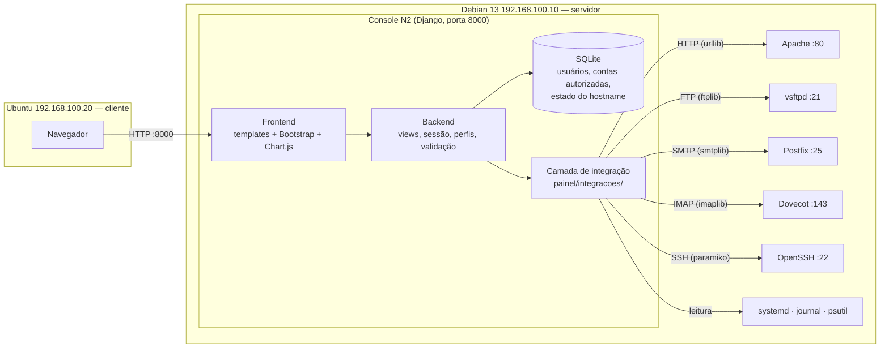

# Console Integrado de Serviços — N2 (Parte 1)

IFCE · Engenharia de Software · Redes de Computadores II · Prof. Matias

**Aluno:** Ygor Venceslau

Console web que centraliza a operação dos serviços configurados na N1 (Apache, vsftpd,
Postfix, Dovecot e OpenSSH). Todas as operações usam os **protocolos reais**
(HTTP, FTP, SMTP, IMAP e SSH) a partir do backend, e os dados exibidos vêm do Debian.

---

## Ambiente

| Item | Valor |
|---|---|
| Servidor | Debian 13.6 — `192.168.100.10` (rede interna `lab`) |
| Cliente | Ubuntu — `192.168.100.20` (navegador) |
| Linguagem | Python 3.13.5 |
| Framework | Django 6.1.3 |
| Banco | SQLite (usuários, contas autorizadas e estado do hostname) |
| Integração | `ftplib`, `smtplib`, `imaplib` (biblioteca padrão), `paramiko` 5.1.0 (SSH) |
| Métricas | `psutil` 7.2.2 e `systemctl show` |
| Interface | Templates Django + Bootstrap 5.3.3 + Chart.js 4.4.4 (**servidos localmente**, sem CDN) |
| Configuração | `python-dotenv` 1.2.4 (segredos no `.env`, fora do Git) |

**Por que Django?** Ele já traz autenticação, sessão, grupos, proteção CSRF, escape de HTML
e ORM num único projeto. Isso reduz o número de componentes e permite concentrar o trabalho
nas integrações e nas regras de permissão, como sugere a seção 6 do enunciado.

---

## Arquitetura



| Camada | Onde fica | Responsabilidade |
|---|---|---|
| Frontend | `painel/templates/`, `painel/static/` | Telas, gráficos, validação no navegador, notificações |
| Backend | `painel/views.py`, `painel/permissoes.py`, `painel/operacoes.py` | Sessão, perfis, autorização **no servidor**, regras e respostas |
| Persistência | `painel/models.py` (SQLite) | Usuários, perfis, contas de correio autorizadas, hostname original |
| Integração | `painel/integracoes/` | `metricas.py`, `ftp.py`, `correio.py`, `ssh.py`, `logs.py` |

Mensagens continuam no IMAP (Maildir do Dovecot) e arquivos no armazenamento do vsftpd
(`/srv/portal/arquivos`); o console não copia nem lê esses dados direto do disco.

---

## Estrutura

```
console-n2/
├── config/                 configurações do Django (settings, urls)
├── painel/
│   ├── integracoes/        camada de integração (FTP, SMTP/IMAP, SSH, métricas, logs)
│   ├── management/         comando criar_perfis
│   ├── templates/          telas
│   ├── static/             CSS, JS e bibliotecas locais (Bootstrap, Chart.js)
│   ├── models.py           ContaCorreio, EstadoHostname
│   ├── permissoes.py       perfis e decorador perfil_requerido
│   ├── operacoes.py        operações recentes da sessão
│   └── views.py
├── deploy/                 configurações do servidor (script, sudoers, sshd)
├── .env.example            modelo de configuração, sem segredos
└── requirements.txt
```

---

## Instalação e execução (no Debian)

### 1. Projeto

```bash
sudo apt install -y python3-venv git
git clone git@github.com:ygorvenceslau/console-n2.git ~/console-n2
cd ~/console-n2
python3 -m venv .venv && source .venv/bin/activate
pip install -r requirements.txt
cp .env.example .env && chmod 600 .env      # preencher os valores
python manage.py migrate
python manage.py criar_perfis               # administrador, operador, leitor
python manage.py createsuperuser
```

### 2. Variáveis do `.env`

| Variável | Uso |
|---|---|
| `DJANGO_SECRET_KEY` | chave do Django (gerar com `get_random_secret_key`) |
| `DJANGO_DEBUG` | `1` em laboratório, `0` em produção |
| `CONSOLE_SERVIDOR_IP` | `192.168.100.10` |
| `CONSOLE_FTP_USUARIO` / `CONSOLE_FTP_SENHA` | conta FTP da N1 (`ftpuser`) |
| `CONSOLE_EMAIL_SENHA_ALUNO` / `CONSOLE_EMAIL_SENHA_SUPORTE` | senhas IMAP das contas de teste |
| `CONSOLE_SSH_CHAVE` / `CONSOLE_SSH_KNOWN_HOSTS` | opcionais; padrão em `~/.console-n2/` |

### 3. Preparação do servidor (uma vez)

```bash
# leitura de logs sem root
sudo usermod -aG adm,systemd-journal vboxuser

# conta técnica do SSH (somente chave)
sudo adduser --system --group --home /var/lib/console-ssh --shell /bin/bash console-ssh
sudo usermod -p '*' console-ssh
mkdir -p ~/.console-n2 && chmod 700 ~/.console-n2
ssh-keygen -t ed25519 -N "" -C "console-n2-backend" -f ~/.console-n2/id_ed25519
sudo install -d -m 700 -o console-ssh -g console-ssh /var/lib/console-ssh/.ssh
echo "restrict $(cat ~/.console-n2/id_ed25519.pub)" | sudo tee /var/lib/console-ssh/.ssh/authorized_keys
sudo chown console-ssh:console-ssh /var/lib/console-ssh/.ssh/authorized_keys
sudo chmod 600 /var/lib/console-ssh/.ssh/authorized_keys

# operação predefinida + sudo limitado + AllowUsers
sudo install -m 755 -o root -g root deploy/console-hostname /usr/local/sbin/console-hostname
sudo install -m 440 -o root -g root deploy/sudoers-console-ssh /etc/sudoers.d/console-ssh
sudo visudo -cf /etc/sudoers.d/console-ssh
sudo install -m 644 deploy/50-console-n2.conf /etc/ssh/sshd_config.d/50-console-n2.conf
sudo sshd -t && sudo systemctl reload ssh

# identidade do servidor (conferir se as duas impressões digitais são iguais)
ssh-keyscan -t ed25519 192.168.100.10 2>/dev/null > ~/.console-n2/known_hosts
ssh-keygen -lf ~/.console-n2/known_hosts
sudo ssh-keygen -lf /etc/ssh/ssh_host_ed25519_key.pub
```

As contas de correio permitidas a cada usuário são cadastradas em `/admin/` → **Contas de correio**.

### 4. Executar

```bash
python manage.py runserver 0.0.0.0:8000
```

Acesso pelo Ubuntu: `http://192.168.100.10:8000/`

---

## Perfis e permissões

A verificação é feita **no backend** (`painel/permissoes.py`). Ocultar um botão não é o controle:
acessar a rota diretamente retorna **403**.

| Ação | Administrador | Operador | Leitor |
|---|:-:|:-:|:-:|
| Visão geral, serviços, HTTP e logs | ✔ | ✔ | ✔ |
| Listar, baixar e verificar arquivos | ✔ | ✔ | ✔ |
| Enviar arquivo por FTP | ✔ | ✔ | ✖ |
| Ler e-mail das contas autorizadas | todas | autorizadas | autorizadas |
| Enviar e responder e-mail | ✔ | ✔ | ✖ |
| Consultar o servidor por SSH | ✔ | ✔ | ✔ |
| Alterar e restaurar o hostname | ✔ | ✖ | ✖ |
| Administração (`/admin/`) | ✔ | ✖ | ✖ |

---

## Funcionalidades

- **Login e sessão:** mensagens de credenciais inválidas e de sessão expirada; a sessão expira após 30 min sem uso e ao fechar o navegador.
- **Visão geral:** CPU, memória, disco e uptime; gráfico de CPU e memória e de latência HTTP com amostras reais; estado dos 5 serviços; operações recentes da sessão; notificações de sucesso, falha e perda de comunicação.
- **Serviços / HTTP:** estado no systemd, teste de porta e teste HTTP com código, duração e instante; acesso ao site e aos arquivos publicados.
- **Arquivos (FTP):** envio pelo formulário (o backend transfere ao vsftpd com `STOR`), progresso, listagem, download por `RETR`, link para a publicação HTTP e **comparação SHA-256** entre o arquivo enviado, o recuperado por FTP e o publicado por HTTP.
- **E-mail:** seleção da conta autorizada, envio por SMTP, cópia em `Sent` por IMAP `APPEND`, Recebidas, leitura e resposta. Falha de envio e falha da cópia são tratadas **separadamente**; se o SMTP já aceitou, a mensagem **não é reenviada** (há um botão para tentar só a cópia).
- **SSH:** conexão real com a conta técnica `console-ssh`, identificação do usuário e do servidor, impressão digital verificada e alteração **reversível** do hostname (o valor original fica guardado no banco).
- **Logs técnicos:** seleção do serviço, limite de linhas (20 a 200), período, filtro por texto, destaque de linhas de erro e mascaramento de termos como `password=`.

---

## Acompanhamento: decisões documentadas

| Item | Decisão |
|---|---|
| Intervalo de atualização | **5 s** por *polling* (`/api/metricas/`); logs sob demanda |
| Dados desatualizados | aviso após **15 s** (3 intervalos) sem coleta bem-sucedida, mantendo o horário da última coleta |
| Falha de comunicação | serviços passam a **"Desconhecido"** (não "parado") |
| CPU | `psutil.cpu_percent(interval=0.5)`: % médio de uso de todos os núcleos numa janela de 0,5 s |
| Memória | usada = total − **disponível** (também exibe o disponível) |
| Disco | sistemas de arquivos de `/` e `/srv/portal/arquivos` |
| Latência HTTP | medida **no backend (Debian)**; a comparação com o cliente usa `curl` no Ubuntu |
| Histórico | gráficos e operações mantidos só durante a sessão (persistência fica para a Parte 2) |

---

## Segurança

- A aplicação **não roda como root**, e o backend não tem sudo irrestrito.
- O SSH usa a conta técnica `console-ssh`: **só chave**, chave com `restrict`, aceita apenas a partir de `192.168.100.10` e com sudo liberado **somente** para `/usr/local/sbin/console-hostname`, que valida o nome.
- A **identidade do servidor** é verificada pelo `known_hosts` (`RejectPolicy`).
- `AllowUsers` restringe o SSH a `vboxuser`, `administrador` e `console-ssh@192.168.100.10`.
- A **chave privada** fica em `~/.console-n2/`, fora do repositório e do navegador.
- Senhas e segredos ficam no `.env` (permissão 600, ignorado pelo Git). As senhas de usuários do console usam o hash padrão do Django (PBKDF2).
- Nenhuma entrada do usuário vai para o shell: as integrações usam bibliotecas de protocolo, comandos com lista fixa de argumentos e `shlex.quote`.
- Validação de nomes de arquivo, extensões (`.pdf .txt .png .jpg .jpeg`), tamanho (10 MB), destinatários (`@empresa.test`), assunto e hostname.
- CSRF em todos os formulários, escape de HTML nos templates e no JavaScript, e timeouts em todas as conexões.
- O backend acessa o correio por SMTP/IMAP, sem leitura dos Maildirs; o Apache só lê os arquivos publicados.
- Logs lidos apenas pelos grupos de leitura `adm` e `systemd-journal`.
- Os protocolos legados da N1 continuam sem TLS e **restritos à rede interna isolada**.

---

## Parte 2 (previsto)

Auditoria persistente, controles de iniciar/parar/reiniciar serviços, edição de configurações,
administração ampliada de usuários, HTTPS no console e novos serviços empresariais.

---

## Evidências

A ficha de verificação com os testes e os prints fica em [`docs/ficha-verificacao.md`](docs/ficha-verificacao.md).

O mockup navegável das telas e fluxos está em [`docs/mockup.html`](docs/mockup.html). O GitHub exibe o código do arquivo: para ver o protótipo, baixe-o e abra no navegador (funciona sem internet).
