# Ficha de verificação — Console N2 (Parte 1)

IFCE · Redes de Computadores II · Prof. Matias · Aluno: Ygor Venceslau

- **Data dos testes:** 08/11/2026
- **Servidor:** Debian 13.6 — `192.168.100.10` (backend do console na porta 8000)
- **Cliente:** Ubuntu — `192.168.100.20` (Firefox)
- **Usuários de teste do console:** `admin` (administrador), `operador1` (operador), `leitor1` (leitor)

---

## Resumo das verificações de aceitação (seção 8.2 do enunciado)

| # | Verificação | Resultado | Evidências |
|:-:|---|:-:|---|
| 1 | Entrar no console, consultar o servidor e verificar a atualização de métricas reais | ✅ | 01, 02, 03, 03b, 03c |
| 2 | Acessar o site e comparar o teste HTTP com a resposta obtida no cliente | ✅ | 04, 05 |
| 3 | Enviar arquivo pelo painel, listá-lo, baixá-lo e localizá-lo na publicação HTTP | ✅ | 06, 07 |
| 4 | Enviar mensagem, ler na conta destinatária, responder e consultar Enviados após nova sessão | ✅ | 08, 09, 09b, 10 |
| 5 | Alterar e restaurar o nome do Debian pela operação SSH do console | ✅ | 11, 12 |
| 6 | Consultar logs e demonstrar tratamento de erro sem expor credenciais | ✅ | 13, 03 |
| 7 | Confirmar que o leitor não executa operações de escrita, mesmo acessando a rota diretamente | ✅ | 14, 15 |

---

## 1. Sessão e acompanhamento

| Teste | Esperado | Obtido | Resultado |
|---|---|---|:-:|
| Login com senha errada | mensagem de credencial inválida, sem entrar | "Usuário ou senha inválidos" | ✅ |
| Visão geral | CPU, memória, disco e uptime reais, com unidades e servidor identificado | CPU 2,1 %, memória 0,35 / 1,93 GB, disco 1,7 / 18,5 GB, uptime 7 h 11 min, host `localhost (192.168.100.10)` | ✅ |
| Atualização | novas amostras a cada 5 s no gráfico | gráfico com amostras de 5 em 5 s e "última coleta às…" | ✅ |
| Perda de comunicação (servidor do console parado) | aviso, horário da última coleta mantido, sem inventar valores | "Sem comunicação · última coleta às 18:11:13 (há 38 s)" e aviso de dados desatualizados | ✅ |
| Estado na falha | "desconhecido", e não "parado" | os 5 serviços em "? Desconhecido" | ✅ |
| Reconexão | volta automática ao estado real | os 5 serviços de volta para "● Ativo" | ✅ |

**01 — Login com credencial inválida**
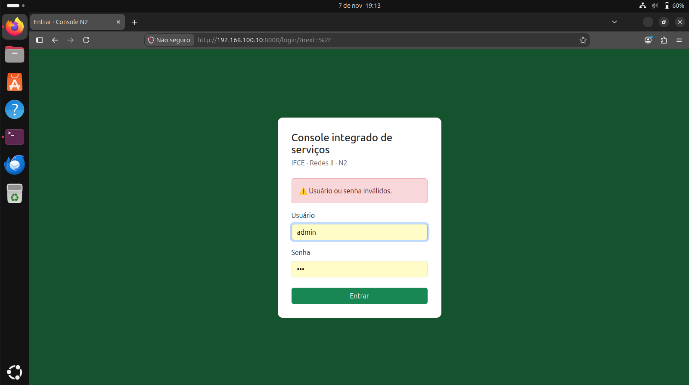

**02 — Visão geral com métricas reais**
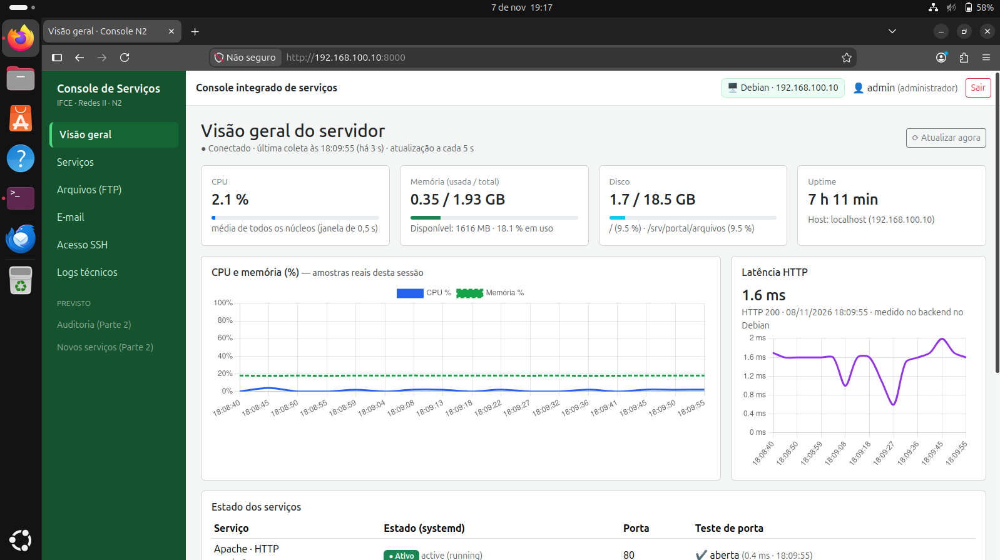

**03 — Perda de comunicação: aviso de dados desatualizados**
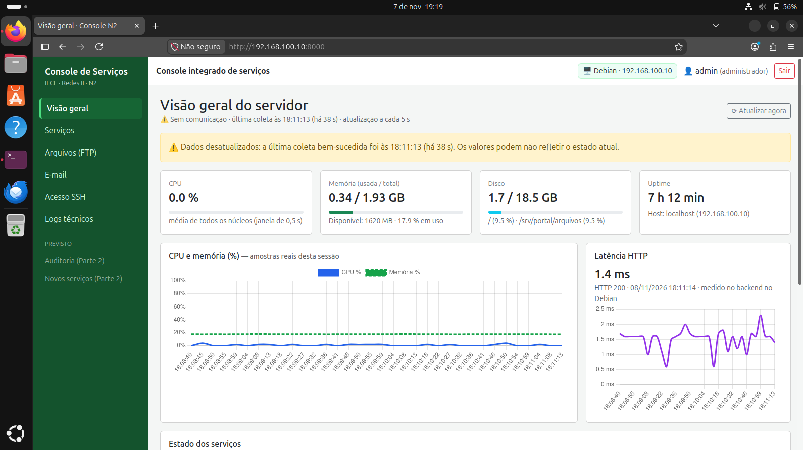

**03b — Serviços em estado desconhecido durante a falha**
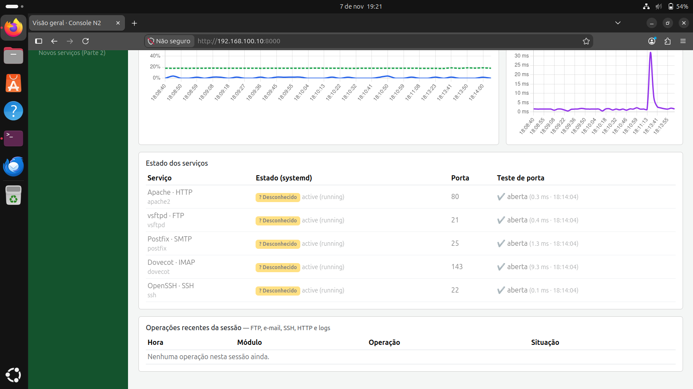

**03c — Reconexão: serviços de volta ao estado real**
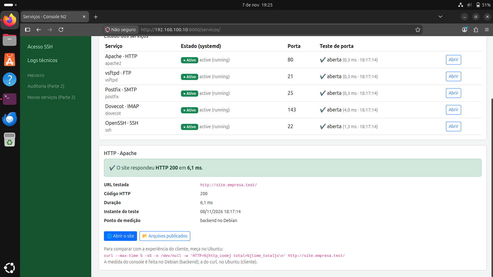

---

## 2. HTTP

| Teste | Esperado | Obtido | Resultado |
|---|---|---|:-:|
| Estado do Apache | ativo | `active (running)`, porta 80 aberta | ✅ |
| Teste HTTP pelo console | código, duração e instante | HTTP 200 em 6,5 ms às 19:48:37 (medido no backend, no Debian) | ✅ |
| Comparação no cliente | mesmo código HTTP | `curl` no Ubuntu: `HTTP=200 total=0.033145s` | ✅ |

A duração difere porque o console mede no Debian e o `curl` mede no Ubuntu; o código HTTP é o mesmo.

**04 — Página Serviços com teste HTTP**
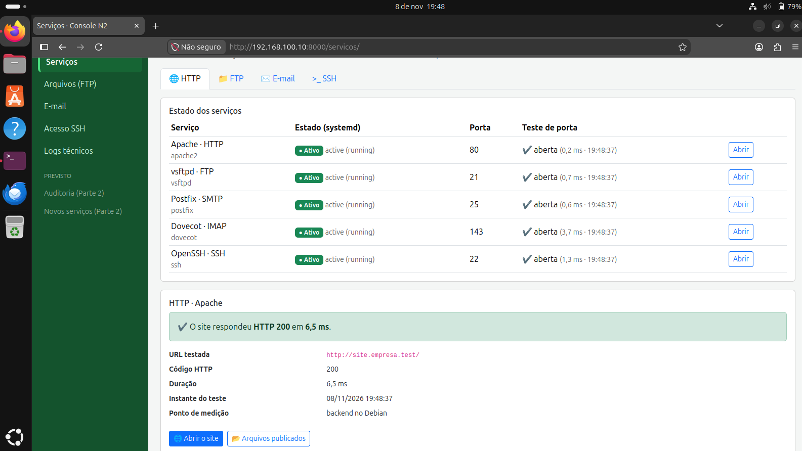

**05 — Teste HTTP no cliente Ubuntu**
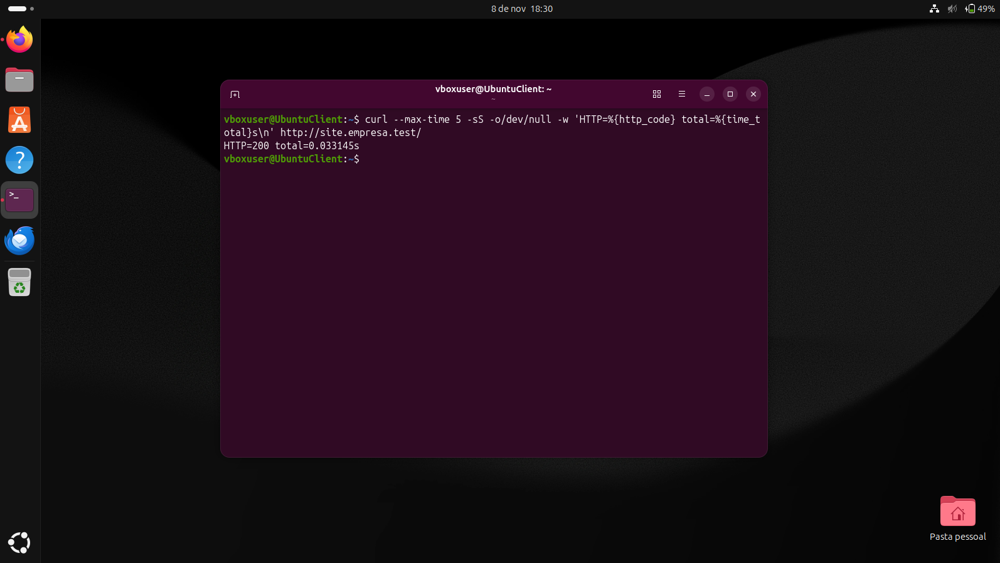

---

## 3. FTP e publicação

| Teste | Esperado | Obtido | Resultado |
|---|---|---|:-:|
| Envio pelo formulário | backend transfere ao vsftpd por FTP | `evidencia-n2.txt`: 44 bytes enviados, 44 no servidor, resposta `226 Transfer complete.` | ✅ |
| Progresso e resultado | estado da operação visível | barra de progresso e "Transferência concluída" | ✅ |
| Publicação HTTP sem cópia manual | arquivo acessível no site | `http://site.empresa.test/arquivos/evidencia-n2.txt` → HTTP 200 | ✅ |
| Integridade | hashes iguais | SHA-256 `dd9268b1aacf44867df946d2e82726532297d9371ed2b0027294d79304000772` no arquivo enviado, no recuperado por FTP e no publicado por HTTP | ✅ |

**06 — Envio por FTP com verificação de integridade**
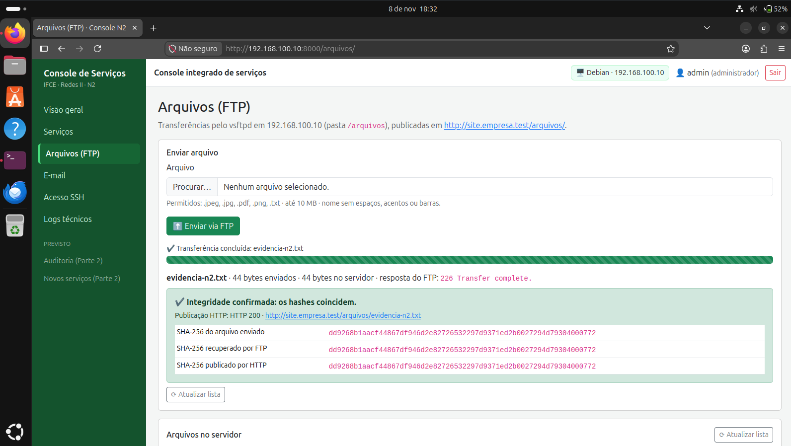

**07 — Arquivo localizado na publicação HTTP**
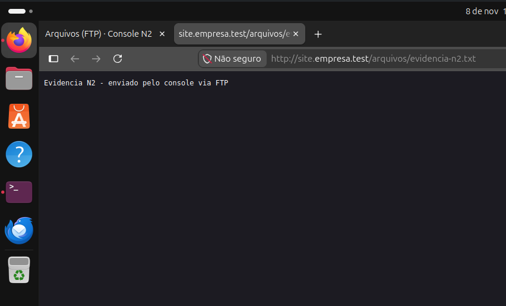

---

## 4. E-mail (SMTP + IMAP)

| Teste | Esperado | Obtido | Resultado |
|---|---|---|:-:|
| Envio por SMTP | mensagem aceita pelo Postfix | `aluno` → `suporte`, fila `C94474004F`, `status=sent (delivered to maildir)` às 18:51:16 | ✅ |
| Cópia em Enviados | mensagem gravada na pasta `Sent` por IMAP | "Teste N2 evidencia" na pasta Enviados do aluno | ✅ |
| Leitura no destinatário | mensagem na caixa do suporte | `doveadm search -u suporte mailbox INBOX` encontrou a mensagem | ✅ |
| Resposta | resposta entregue ao remetente | `suporte` → `aluno`, fila `73D344004F`, `status=sent` às 18:53:23 | ✅ |
| Persistência | mensagens visíveis após nova sessão | Enviados mantidos depois de sair e entrar novamente | ✅ |
| Conferência no servidor | as três evidências da seção 7.4 | `journalctl` do Postfix e `doveadm search` na INBOX do suporte e no Sent do aluno | ✅ |

**08 — Mensagem na pasta Enviados**
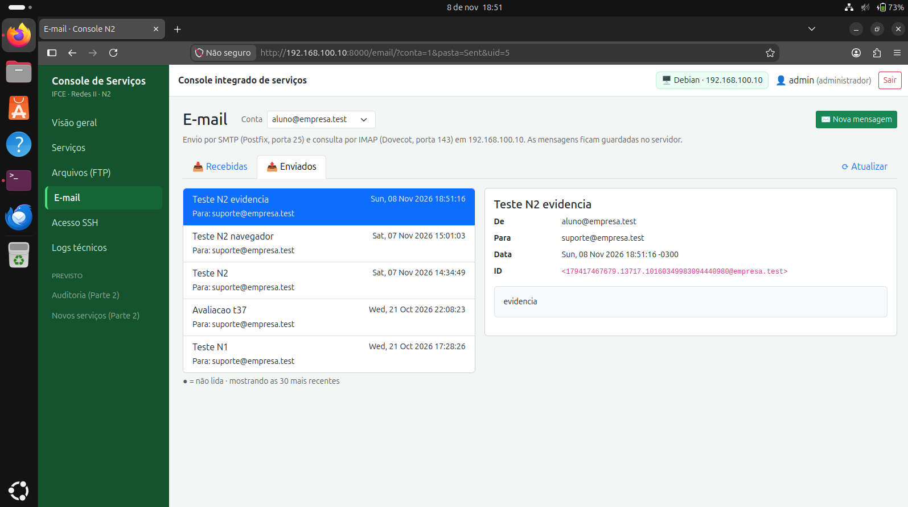

**09 — Resposta recebida pelo aluno**
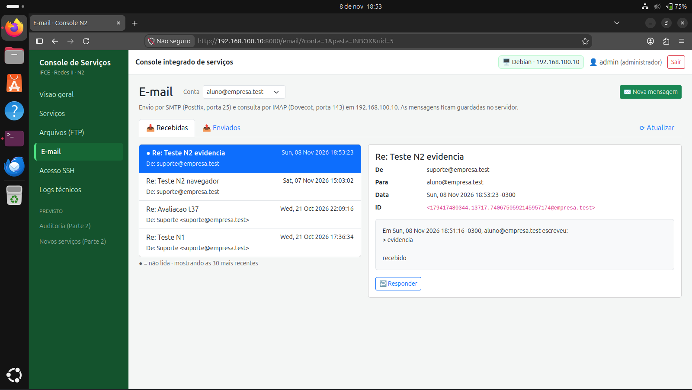

**09b — Enviados após nova sessão**
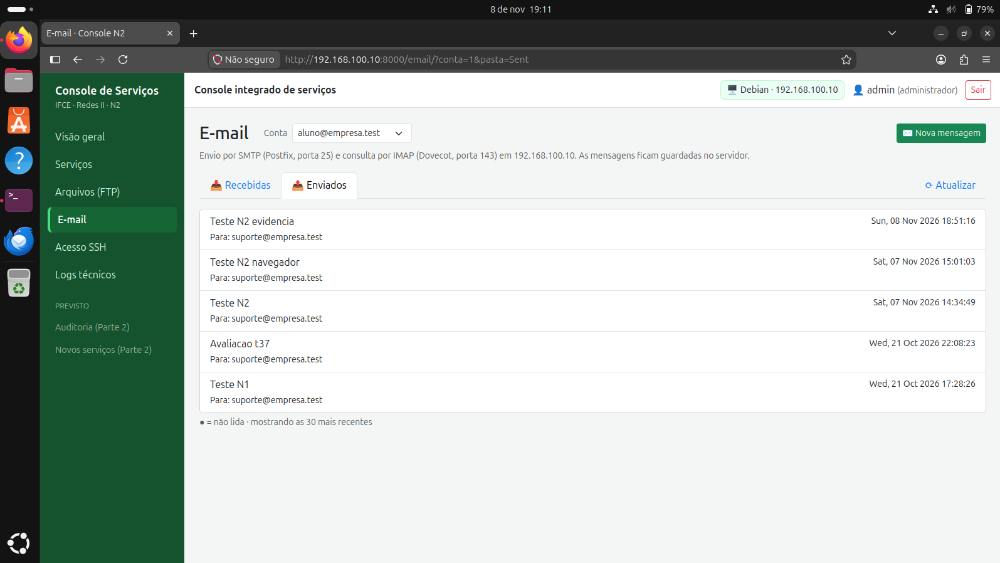

**10 — Conferência no servidor (Postfix e Dovecot)**
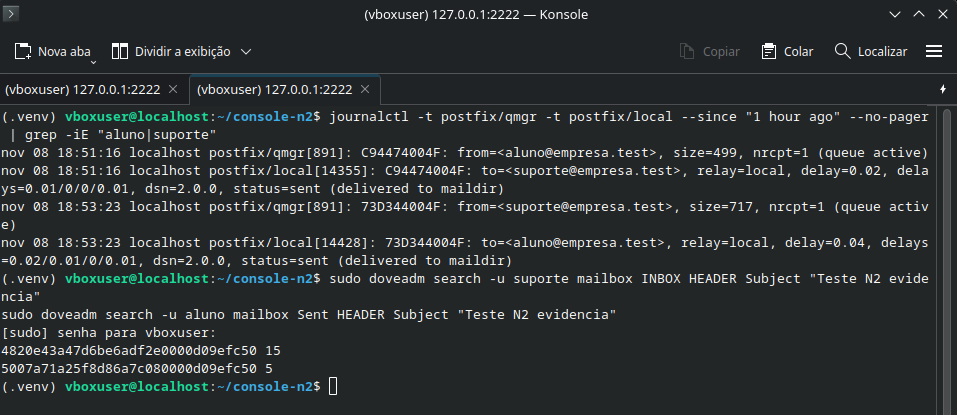

---

## 5. SSH e hostname reversível

| Teste | Esperado | Obtido | Resultado |
|---|---|---|:-:|
| Conexão real | usuário e servidor identificados | usuário remoto `console-ssh`, servidor `192.168.100.10:22` | ✅ |
| Identidade do servidor | verificada pelo known_hosts | `ssh-ed25519 SHA256:VKpIFWmVSVcK+wQXekpNBirA+2barUyYUxSuA+eV4Js` | ✅ |
| Alteração | nome validado, valor anterior guardado, resultado confirmado | `localhost` → `servidor-n2-teste`, "valor original guardado: localhost" | ✅ |
| Restauração | volta ao valor original | `servidor-n2-teste` → `localhost`, confirmado com `hostnamectl --static` | ✅ |
| Privilégio limitado | sudo só para a operação predefinida | `sudo -n hostnamectl` e `sudo -n cat /etc/shadow` recusados para `console-ssh` | ✅ |

**11 — Hostname alterado pelo console (navegador e terminal)**
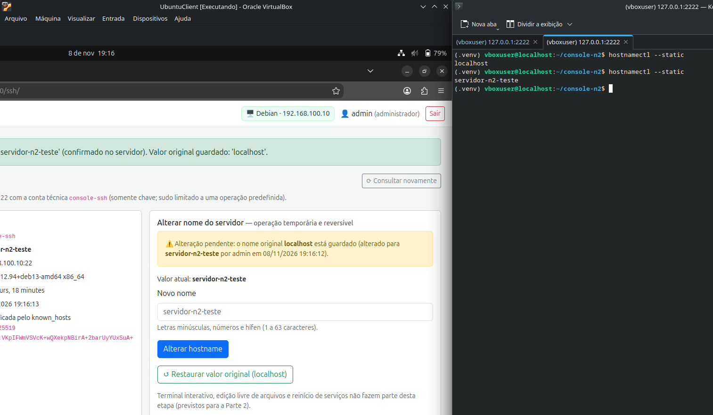

**12 — Hostname restaurado: localhost → servidor-n2-teste → localhost**
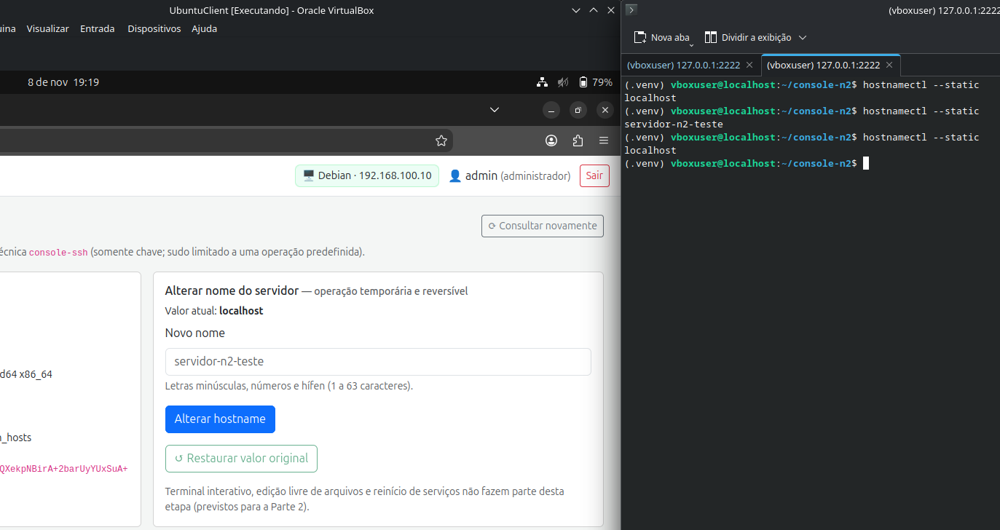

---

## 6. Logs técnicos

| Teste | Esperado | Obtido | Resultado |
|---|---|---|:-:|
| Seleção e limite | serviço escolhido e linhas limitadas | OpenSSH · SSH, 20 linhas, origem `journalctl -u ssh` | ✅ |
| Filtro | apenas linhas com o texto | busca "aluno": 8 de 8 linhas | ✅ |
| Destaque de erros | linhas de falha marcadas | linhas com ⚠, incluindo "not allowed because not listed in AllowUsers" | ✅ |
| Credenciais | não expor segredos | termos como `password=` mascarados; mensagens de erro sem senhas | ✅ |

**13 — Logs do SSH filtrados**
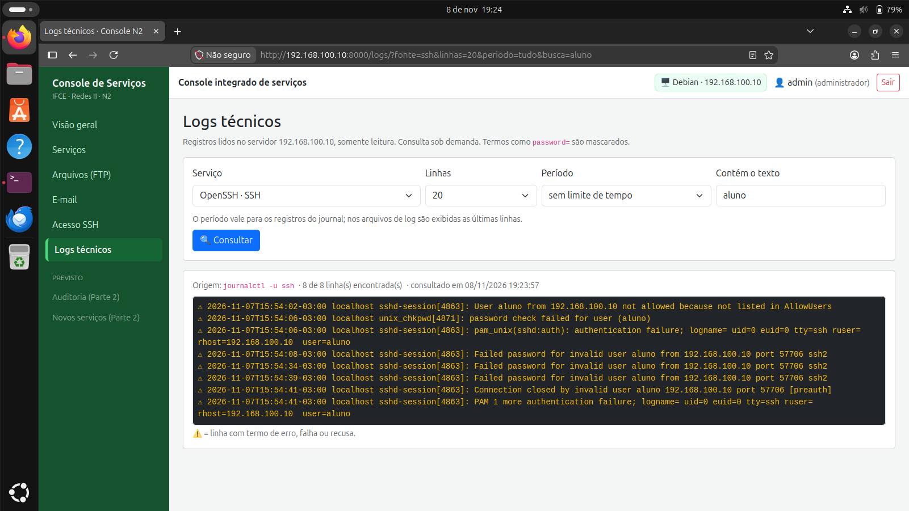

---

## 7. Permissões

| Teste | Esperado | Obtido | Resultado |
|---|---|---|:-:|
| Interface do leitor | sem formulário de envio | "Seu perfil (leitor) permite apenas listar, baixar e verificar arquivos" | ✅ |
| Rota acessada diretamente | bloqueio no backend | `leitor1` em `/email/nova/?conta=1` → **403 Acesso negado** | ✅ |
| Teste automatizado da rota de envio | leitor bloqueado, operador autorizado | `leitor1` → 403; `operador1` → 400 (autorizado, sem arquivo) | ✅ |

**14 — Leitor sem formulário de envio**
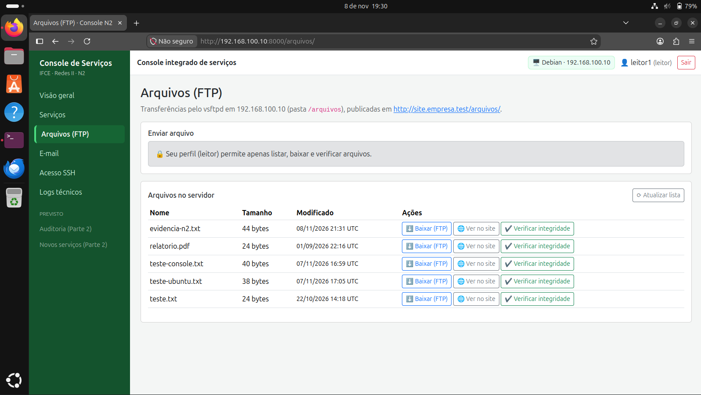

**15 — Leitor bloqueado pelo backend (403)**
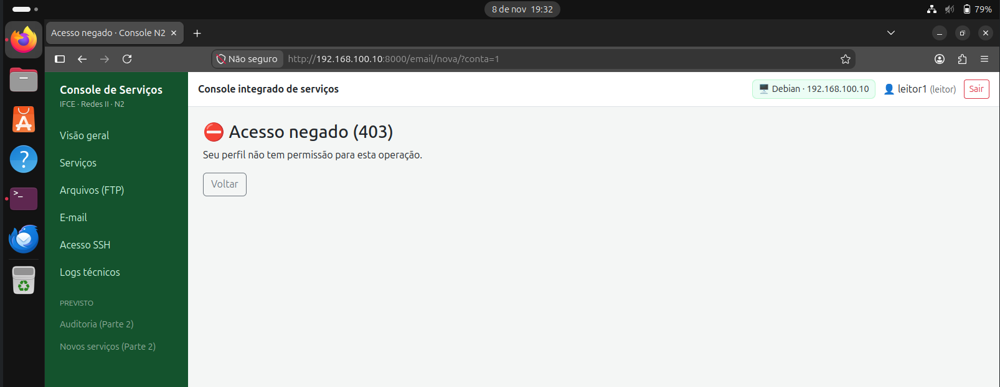

---

## 8. Operações recentes da sessão

Cada ação registra hora, módulo, descrição, detalhe e situação (concluída ou falha).

**16 — Operações recentes**
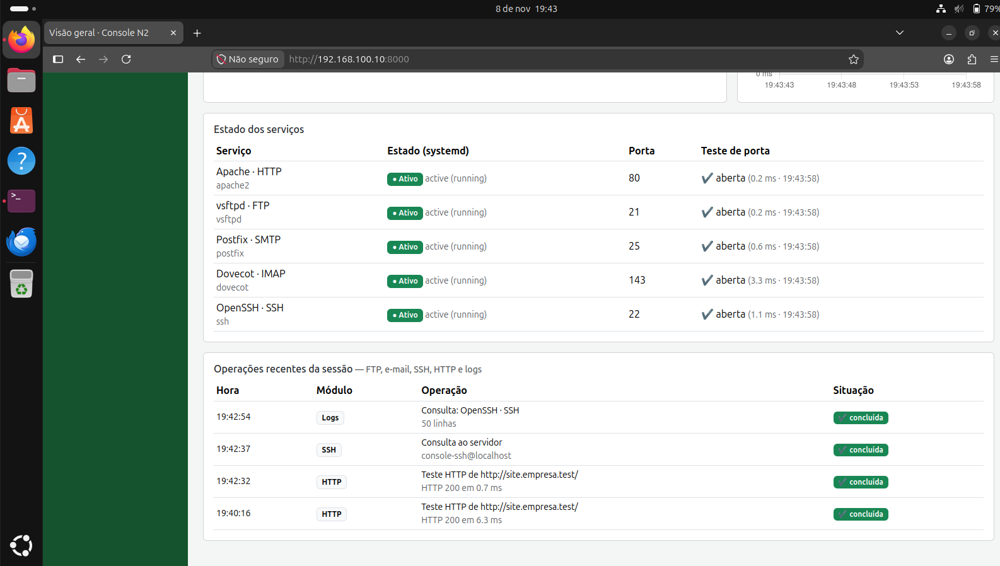
